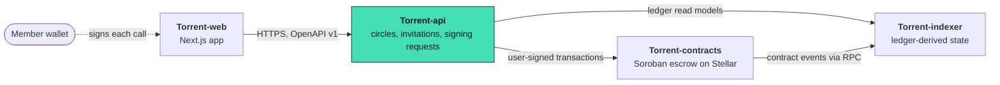

<div align="center">


# Torrent-api

**The off-chain backend for Torrent: circles, invitations, wallet sign-in and signing requests.**

[](https://github.com/Torrent998/Torrent-api/actions/workflows/ci.yml)
[](./LICENSE)
[](#status)
[](#status)

Part of **Torrent** — ownership of *when* money becomes available.

</div>

<picture>
  <source media="(prefers-color-scheme: dark)" srcset="https://raw.githubusercontent.com/Torrent998/Torrent-web/main/docs/screenshots/landing-hero-1440-dark.png" />
  
</picture>

## This repository

The authoritative off-chain backend. It owns people, policy and workflow, **not money**:

- **Circles and invitations**: rule sets hashed into the policy hash that binds a circle to its on-chain pool;
  single-use invitation codes stored hashed.
- **Wallet sign-in**: SEP-53 `signMessage` challenge (single use, 5 min) -> 12 h revocable session; an `auditor`
  role by configured address.
- **Signing requests (intents)** for every member-signed contract call: deposit, propose / accept / **cancel**
  a transfer, claim and **leave the pool**. States `DRAFT -> VERIFIED -> AWAITING_SIGNATURE -> SUBMITTED -> CONFIRMED`, with
  `FAILED` and `RECONCILING`. Idempotency keys on every write; a signed transaction is checked against the approved
  intent before submission; timeouts reconcile by transaction hash and are never retried with new parameters.
- **Ledger truth comes from the indexer**: coverage, ownership, pool status (Active / Paused / Closed) and contract
  governance (`GET /v1/contract`: pending timelocked upgrade, upgrade lock) are read from Torrent-indexer; the API
  cannot override confirmed on-chain state. It pre-checks the contract's rules (closed pools, matured rights, offers
  that would outlive maturity, leaving while owning a right) so nobody is asked to sign a doomed transaction.
- **Append-only audit trail**, request ids, rate limiting, standard error schema.

Public boundary: [`openapi/openapi.v1.json`](./openapi/openapi.v1.json) (OpenAPI 3.1, generated from the same Zod
registry that validates requests). It consumes Torrent-indexer v1 (`fixtures/`) and targets Torrent-contracts **ABI v2**.

## Quickstart

Requires Node.js 22.12 or newer.

```bash
git clone https://github.com/Torrent998/Torrent-api && cd Torrent-api
npm ci
npm run check            # typecheck + eslint + vitest
npm run build
cp .env.example .env     # set TORRENT_ESCROW_CONTRACT_ID; INDEXER_BASE_URL -> a running torrent-indexer
npm start                # http://localhost:3001  (/healthz, /v1/openapi.json)
```

`npm start` loads `.env` when present and refuses to start without the required settings. State is SQLite at
`DATABASE_PATH` (default `data/torrent-api.db`, git-ignored). Only Testnet is accepted. Stop with Ctrl-C/SIGTERM.
No Testnet deployment of the contract exists yet, so a local run can serve sign-in, circles and invitations but
cannot confirm on-chain actions.

## Status

| Area | State |
|---|---|
| All SRD v1 endpoints plus additive ones (transfer cancel, leave-pool intent, contract governance view), Zod validation, standard errors, request ids, rate limiting | implemented |
| OpenAPI 3.1 generated from the Zod registry; snapshot and route-parity tests | implemented |
| Intent state machine (funding, transfer propose/accept/cancel, claim, pool leave), idempotency, signed-XDR verification against the approved intent | implemented, failure paths tested (timeouts, expiry, stale authorization, tampered transactions, closed pools, matured rights) |
| Ledger-derived coverage and ownership via the indexer HTTP client | implemented; contract-tested against the indexer's real recorded responses |
| Persistence | SQLite (`node:sqlite`, WAL, versioned migrations, append-only audit). `node:sqlite` is experimental in Node 22. No PostgreSQL/Redis yet |
| Authentication | wallet-signature login. No KYC or eligibility provider |
| `SorobanRpcSubmitter` | compiled, **never run against live Testnet** |
| Tests | 98 passing (plus 1 golden-regeneration test that only runs with `UPDATE_GOLDEN=1`); test doubles in `test/fakes.ts` are labelled **TEST ADAPTERS** |
| Security audit / Mainnet | **no** / **no** |

Design records: [docs/adr/](./docs/adr/).

## What is Torrent?

In a savings circle, members contribute to a shared pot and take turns receiving it. Sometimes a member
needs their payout earlier, or would happily take it later. **Torrent lets members exchange the timing of a
payout, but only for payouts that are already fully funded.**

1. **Create a circle.** An organizer sets the rules; their hash binds the circle to an on-chain pool.
2. **Fund the pool.** Members deposit a supported Stellar asset into a Soroban escrow contract.
3. **Issue payout rights.** Each right has a unique id, owner, amount and maturity. The contract refuses to
   issue a right that is not covered by unreserved escrow.
4. **Transfer or claim.** The owner proposes, the recipient accepts, both sign. At maturity the current owner
   claims exactly once.

The contract enforces one invariant after every call: `reserved <= funded - claimed - withdrawn`.
A payout right never represents a future contribution that has not been paid.

## Architecture

Torrent is four independently tested repositories, each owning one boundary. The contract is the only source of truth for backing, ownership and payout; the indexer reconstructs that truth from the ledger; the API organizes people and signing requests; the web app shows it honestly.



| Repository | Stack | Owns |
|---|---|---|
| [Torrent-contracts](https://github.com/Torrent998/Torrent-contracts) | Rust · Soroban SDK 29 | Escrow pools, fully backed payout rights, member-only transfers and one-time claims. The only writer of financial truth. |
| [Torrent-indexer](https://github.com/Torrent998/Torrent-indexer) | TypeScript · Node 22 · Stellar RPC | Ingests contract events with a durable cursor and rebuilds pools, rights and transfers from the ledger. |
| **[Torrent-api](https://github.com/Torrent998/Torrent-api)** (this repo) | TypeScript · NestJS · SQLite | Circles, invitations, wallet sign-in and the signing-request state machine. Holds no keys and no balances. |
| [Torrent-web](https://github.com/Torrent998/Torrent-web) | TypeScript · Next.js 16 · Tailwind CSS 4 | Landing page and web app: circles, coverage, rights, transfers, claims and signing requests. |

## Project documents

| Document | What it covers |
|---|---|
| [docs/PRD.md](./docs/PRD.md) | Product purpose, users, MVP and non-goals |
| [docs/SRD.md](./docs/SRD.md) | Domain model, state machine, API surface |
| [docs/ARCHITECTURE.md](./docs/ARCHITECTURE.md) | The four repositories and how data flows between them |
| [docs/STELLAR_PROTOCOL.md](./docs/STELLAR_PROTOCOL.md) | Contract specification and invariants |
| [docs/SECURITY.md](./docs/SECURITY.md) | Threat model and go-live restrictions |
| [docs/ROADMAP.md](./docs/ROADMAP.md) | Milestones and quality gates |
| [docs/BRAND.md](./docs/BRAND.md) | Approved logo and interface principles |
| [docs/adr/](./docs/adr/) | Architecture decision records for this repository |
| [AGENTS.md](./AGENTS.md) | Rules for AI coding agents working in this repository |

The shared product documents are mirrored in all four repositories; the canonical copy lives in
[Torrent-api](https://github.com/Torrent998/Torrent-api/tree/main/docs).

## Contributing and Drips Wave

Contributions are welcome. Start with [CONTRIBUTING.md](./CONTRIBUTING.md), then pick a scoped task from
[docs/CONTRIBUTOR_ISSUES.md](./docs/CONTRIBUTOR_ISSUES.md). Each task names its motivation, the files it touches,
acceptance tests and non-goals. Changes that cross a repository boundary go through the versioned fixtures
each repo publishes, so every PR stays reviewable on its own.

Torrent intends to apply to the [Drips Wave](https://docs.drips.network/wave/maintainers/participating-in-a-wave/)
program for Stellar projects. Participation is subject to Drips' review; nothing here implies approval or rewards.
Please follow the [Code of Conduct](./CODE_OF_CONDUCT.md).

## Security

Torrent is an **unaudited prototype for Stellar Testnet**. Do not use it with real funds.
Please report vulnerabilities privately as described in [SECURITY.md](./SECURITY.md); do not open public issues
for them. The threat model is in [docs/SECURITY.md](./docs/SECURITY.md).

## License

[MIT](./LICENSE). The Torrent logo in [`brand/`](./brand/) is the project's approved identity and is shared by all four
repositories; see [brand/README.md](./brand/README.md) for usage rules.
